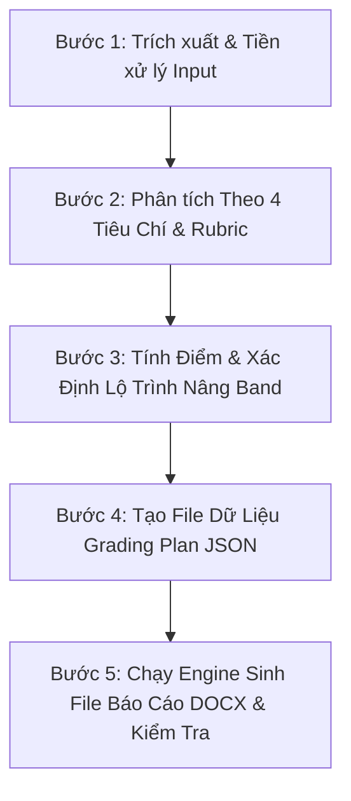

# IELTS Writing Grader — Comprehensive Evaluation & Report Generator Skill

Bộ kỹ năng chuyên gia chấm thi và biên soạn báo cáo đánh giá **IELTS Academic Writing** (Task 1 & Task 2) chuẩn quốc tế. Skill này được thiết kế để bất kỳ AI Agent nào (Antigravity, Claude Code, Cursor, Codex, v.v.) đều có thể cài đặt, học và thực thi quy trình chấm bài nhất quán.

---

## 1. Mục Đích & Phạm Vi Ứng Dụng (Capabilities)

- **Chấm thi theo chuẩn quốc tế**: Đánh giá dựa trên văn bản chính thức của **IELTS Writing Band Descriptors** (British Council, IDP, Cambridge Assessment English).
- **Phân tích 4 tiêu chí độc lập (25% mỗi tiêu chí)**:
  - Task 1: **Task Achievement (TA)**, **Coherence & Cohesion (CC)**, **Lexical Resource (LR)**, **Grammatical Range & Accuracy (GRA)**.
  - Task 2: **Task Response (TR)**, **Coherence & Cohesion (CC)**, **Lexical Resource (LR)**, **Grammatical Range & Accuracy (GRA)**.
- **Tính điểm & Làm tròn chuẩn IELTS**:
  - Tính điểm trung bình cộng 4 tiêu chí.
  - Áp dụng thuật toán làm tròn chính thức: $.25 \rightarrow .5$, $.75 \rightarrow$ làm tròn lên số nguyên kế tiếp.
- **Xuất file báo cáo DOCX chuẩn format**:
  - Bìa báo cáo & bảng thông tin metadata thanh lịch (nền tối `1a1a1a`, chữ trắng).
  - Bảng tổng hợp kết quả (Section I).
  - Bảng phân tích đặc điểm biểu đồ/bản đồ hoặc bảng diễn giải 4 tiêu chí (Section II).
  - Nhận xét chung & lưu ý phương pháp.
  - Phần chi tiết từng học viên:
    - Bài làm giữ nguyên văn, đánh dấu **chữ đỏ gạch chân** cho lỗi/cần nâng cấp và **nền vàng** cho cụm từ tốt.
    - Bảng 2 cột Điểm mạnh / Cần cải thiện.
    - Bảng 3 cột sửa lỗi từ vựng (`Lỗi | Sửa | Giải thích`).
    - Bảng 3 cột sửa lỗi ngữ pháp (`Lỗi | Sửa | Phân tích`).
    - Lộ trình cải thiện & bảng gợi ý dàn ý từng đoạn.
    - Bài viết mẫu tham khảo (Mở bài, Thân bài, Kết luận).
    - Khung Callout Banner kết quả cuối bài với nền đen `1a1a1a` và lộ trình 3 bước.
- **Hỗ trợ 2 chế độ**: Chấm 1 bài đơn lẻ (như `Sample input.docx`) hoặc chấm theo nhóm lớp (Batch 2 - 5 học viên).

---

## 2. Cấu Trúc Thư Mục Của Bộ Skill (Directory Structure)

```text
skills/ielts-writing-grader/
├── SKILL.md                               (Tài liệu vận hành chính của Skill)
├── README.md                              (Hướng dẫn cài đặt & tích hợp cho các Agent khác)
├── references/
│   ├── band_descriptors_task1.json        (Toàn văn Band Descriptors Task 1)
│   ├── band_descriptors_task2.json        (Toàn văn Band Descriptors Task 2)
│   ├── band_descriptors_task1.md          (Bảng tra cứu Task 1 định dạng Markdown)
│   ├── band_descriptors_task2.md          (Bảng tra cứu Task 2 định dạng Markdown)
│   ├── task1_rubric_guide.md              (Hướng dẫn chấm chuyên sâu Task 1)
│   ├── task2_rubric_guide.md              (Hướng dẫn chấm chuyên sâu Task 2)
│   ├── report_format_specification.md     (Đặc tả định dạng file DOCX chuẩn XML)
│   ├── grading_plan_schema.json           (JSON Schema cho file kế hoạch chấm điểm)
│   ├── grading_plan_example_task1.json    (File JSON mẫu Task 1 - Bản đồ 1990 và Nay)
│   └── grading_plan_example_task2.json    (File JSON mẫu Task 2 - Tuổi nghỉ hưu)
└── scripts/
    ├── extract_input.py                   (Trích xuất đề và bài làm từ .docx/.txt)
    ├── score_calculator.py                (Bộ tính điểm và làm tròn chuẩn IELTS)
    ├── generate_report_docx.py            (Engine Python thuần sinh file DOCX chuẩn 100%)
    └── validate_report_docx.py            (Kiểm tra tính toàn vẹn của file DOCX đầu ra)
```

---

## 3. Quy Trình Chấm Bài 5 Bước Của AI Agent (Execution Workflow)



### Bước 1: Trích xuất Input
Chạy script trích xuất đề bài, số từ và các đoạn văn bản:
```powershell
py -3.10 "skills/ielts-writing-grader/scripts/extract_input.py" "<input_file.docx>" --json
```
Nếu người dùng paste text trực tiếp, trích xuất đề bài và bài làm từ văn bản.

### Bước 2: Đánh giá theo 4 Tiêu chí & Quy tắc Nghiêm ngặt
1. **Kiểm tra Task 1**:
   - Đã có **Overview rõ ràng** (Band 6+) hay chưa?
   - Đã bao quát đủ các thay đổi lớn nhất (Band 7+) chưa?
   - Có chi tiết hoặc số liệu nào bị sai lệch không?
2. **Kiểm tra Task 2**:
   - **Lỗi mâu thuẫn lập trường**: Mở bài và Kết luận có cùng một quan điểm không? Nếu mở bài bảo vệ ưu điểm nhưng kết luận lại bảo vệ nhược điểm $\rightarrow$ Khóa Task Response ở **Band 5.0**.
   - Dạng bài *Outweigh*: Học viên có chứng minh được bên nào quan trọng hơn không?
   - Có ví dụ thực tế cụ thể không (tên quốc gia, số liệu, đạo luật)?
3. **Quy tắc Trình bày Bảng Điểm mạnh / Điểm cần cải thiện (BẮT BUỘC)**:
   - Mỗi ý trong danh sách `strengths` (Điểm mạnh) hoặc `weaknesses` (Điểm cần cải thiện) **phải là một phần tử riêng trong mảng (`array`)** hoặc được ngăn cách bằng ký tự xuống dòng (`\n`).
   - Ký hiệu tick (`✓`) và cross (`✗`) **luôn luôn nằm ở đầu dòng / đầu đoạn văn**. Tuyệt đối không gộp nhiều ý có tick/cross chung vào một dòng.
   - Khi render DOCX, engine tự động gán thuộc tính `hanging indent` (thụt lề treo) để các dòng sau của cùng một ý không bị chèn dưới dấu tick/cross.
4. **Phân tích lỗi từ vựng & ngữ pháp**:
   - Liệt kê tối thiểu 8 - 12 lỗi từ vựng (dịch thô tiếng Việt, collocation sai, lỗi chính tả).
   - Liệt kê tối thiểu 8 - 12 lỗi ngữ pháp (chia thì, bị động nội động từ, cấu trúc song song, mạo từ).
   - Đánh dấu vị trí các cụm từ tốt và các cụm từ sai trong bài làm để highlight.

### Bước 3: Tính điểm chuẩn xác
Dùng `score_calculator.py` để lấy điểm TB và Band chính thức:
```powershell
py -3.10 "skills/ielts-writing-grader/scripts/score_calculator.py" <C1> <C2> <C3> <C4>
```

### Bước 4: Tạo File Kế Hoạch Chấm Điểm (`grading_plan.json`)
Tạo file JSON tuân thủ `grading_plan_schema.json` chứa toàn bộ nhận xét, bảng lỗi, bài làm đã đánh dấu thẻ `highlight: "error" | "good" | "none"`, kế hoạch cải thiện và bài mẫu viết lại.

### Bước 5: Sinh File DOCX Báo Cáo & Xác Thực
Chạy engine Python độc lập để xuất báo cáo:
```powershell
py -3.10 "skills/ielts-writing-grader/scripts/generate_report_docx.py" --json "grading_plan.json" --output "IELTS_Report_Output.docx"
py -3.10 "skills/ielts-writing-grader/scripts/validate_report_docx.py" "IELTS_Report_Output.docx"
```

---

## 4. Hướng Dẫn Tích Hợp Cho Các AI Agent Khác (Agent Interoperability)

Để một AI Agent mới (ví dụ agent chạy trên hệ điều hành khác hoặc trong IDE Cursor/VS Code/Claude) có thể học và thực thi bộ skill này:

1. **Không yêu cầu thư viện bên ngoài**: Toàn bộ scripts chỉ sử dụng thư viện chuẩn của Python (`zipfile`, `xml.etree.ElementTree`, `json`, `argparse`, `pathlib`, `re`).
2. **Đăng ký vào hệ thống Agent**:
   - Với Antigravity: Thêm tên skill vào file `.agents/skills.json` ở thư mục gốc workspace.
   - Với các Agent khác: Đọc trực tiếp `SKILL.md` và tham chiếu các file trong `references/`.
3. **Tính tái sử dụng**:
   - File JSON trung gian cho phép tách rời hoàn toàn bước suy luận ngôn ngữ (LLM Reasoning) khỏi bước tạo tài liệu nhị phân (DOCX Rendering).
